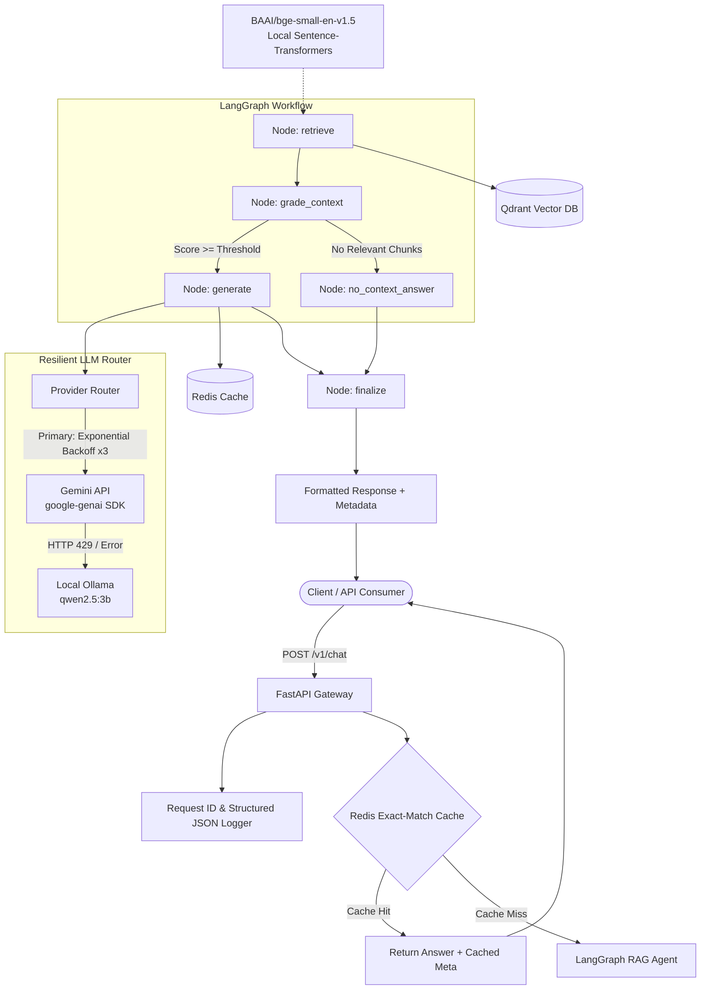

# Sentinel: LLMOps Platform for Reliable AI Agents

Sentinel is a production-grade LLMOps gateway and agent platform engineered for high reliability, zero-cost resilience, and full operational observability.

---

## Architecture (Phase 1)



---

## Key Features

- **$0 Operating Cost & Quota Defense**:
  - Local dense vector embeddings via `BAAI/bge-small-en-v1.5` (sentence-transformers), burning 0 Gemini tokens for search.
  - Redis exact-match response cache instantly serving repeated queries with 0 latency and 0 quota consumption.
- **Official Google GenAI SDK**:
  - Direct integration with Google's modern `google-genai` Python library.
  - Model name dynamically configured via `GEMINI_MODEL` (e.g. `gemini-2.5-flash`), never hardcoded.
- **Self-Healing LLM Fallback**:
  - Exponential backoff retry loop (3 attempts) on upstream 429 / quota exhaustion.
  - Seamless automatic fallback to local Ollama inference (`qwen2.5:3b`).
- **Grounded LangGraph State Machine**:
  - Explicit `ChatState` typed flow (`retrieve` $\rightarrow$ `grade_context` $\rightarrow$ `generate`).
  - Strict context grading threshold prevents hallucinations by safely returning a polite refusal if retrieved documents are not relevant.
- **Full Operational Observability**:
  - Every response includes execution passports: `latency_ms`, `tokens_in`, `tokens_out`, `provider`, `model`, `cache_hit`, and `request_id`.
  - Structured JSON logs propagating `request_id` across all context boundaries via `contextvars`.

---

## Quickstart

### Prerequisites
- Python 3.11+
- Docker & Docker Compose
- (Optional) [Google AI Studio API Key](https://aistudio.google.com/)

### 1. Clone & Configure
```bash
git clone https://github.com/your-org/sentinel.git
cd sentinel

# Copy example environment configuration
cp .env.example .env
```
Edit `.env` to provide your `GEMINI_API_KEY` (if omitted, Sentinel runs in simulated mock mode with `FakeProvider`).

### 2. Start Services via Docker Compose
```bash
docker compose up -d --build
```
This boots:
- **FastAPI Gateway**: `http://localhost:8000`
- **Jaeger Tracing Web UI**: `http://localhost:16686`
- **Qdrant Vector Database**: `http://localhost:6333`
- **Redis Response Cache**: `localhost:6379`
- *(Optional)* **Ollama**: Run `docker compose --profile ollama up -d` for local offline LLM fallback.

### 3. Ingest Sample Documentation
Sentinel ships with sample Kubernetes architecture docs in `./data/docs`:
```bash
# Ingest docs into Qdrant
python scripts/ingest.py --docs-dir data/docs
```

### 4. Query the Gateway
```bash
# Check service health
curl http://localhost:8000/healthz
curl http://localhost:8000/readyz

# Ask a question (synchronous REST)
curl -X POST http://localhost:8000/v1/chat \
  -H "Content-Type: application/json" \
  -d '{"question": "How do Kubernetes Deployments roll out updates?"}'

# Stream answer tokens in real-time (Server-Sent Events)
curl -N -X POST http://localhost:8000/v1/chat/stream \
  -H "Content-Type: application/json" \
  -d '{"question": "How do Kubernetes Deployments roll out updates?"}'

# Submit background document ingestion job (Redis Streams)
curl -X POST http://localhost:8000/v1/ingest/jobs \
  -H "Content-Type: application/json" \
  -d '{"documents": [{"content": "Custom docs text...", "source": "guide.md"}]}'

# Query ingestion job status & progress
curl http://localhost:8000/v1/ingest/jobs/{job_id}
```

Sample JSON response:
```json
{
  "answer": "A Deployment provides declarative updates for Pods and ReplicaSets...",
  "sources": [
    {
      "source": "deployments.md",
      "content": "By default, Kubernetes Deployments use the RollingUpdate strategy...",
      "score": 0.8412
    }
  ],
  "meta": {
    "latency_ms": 340.5,
    "tokens_in": 245,
    "tokens_out": 62,
    "provider": "gemini",
    "model": "gemini-2.5-flash",
    "cache_hit": false,
    "cache_type": "none",
    "cost_usd": 0.000037,
    "guardrail_passed": true,
    "request_id": "req_8a39f1c7e90b",
    "trace_id": "4bf92f3577b34da6a3ce929d0e0e4736",
    "span_id": "00f067aa0ba902b7",
    "groundedness_score": 0.9412,
    "groundedness_passed": true
  }
}
```

---

## Local Development & Testing

```bash
# Install dependencies
pip install -e ".[dev]"

# Run linter & code format checks
ruff check .
ruff format --check .

# Run type checking
mypy sentinel tests scripts

# Run unit & integration tests (runs 100% locally with 0 Gemini quota burned)
pytest -v

# Run automated evaluation benchmark & Groundedness Gate (0-cost offline mode)
python scripts/evaluate.py --dataset data/evals/golden_dataset.json
```

---

## Engineering Roadmap (Phases 2 – 7)

- [x] **Phase 1: Resilient RAG Gateway Foundation**
  - FastAPI Gateway, LangGraph agent, Qdrant vector store, Redis cache, LLM provider fallback, Docker Compose, CI pipeline.
- [x] **Phase 2: Observability & OpenTelemetry Distributed Tracing**
  - OpenTelemetry auto-instrumentation, trace context propagation across LLM and vector steps, export to Jaeger / Phoenix / Langfuse.
- [x] **Phase 3: Automated Evaluations & Groundedness Gate**
  - Continuous evaluation harness with RAG Triad metrics (faithfulness, context recall, answer relevance), golden benchmark dataset, runtime Groundedness Gate, and regression gating CLI.
- [x] **Phase 4: Safety Guardrails, Semantic Caching & Cost Routing**
  - Input/output safety validation (prompt injection detection, PII masking, system leak guard), Qdrant-backed semantic vector cache with cosine matching, dynamic cost-aware router and token pricing accounting.
- [x] **Phase 5: Streaming & Asynchronous Background Tasks**
  - Real-time Server-Sent Events (SSE) token streaming (`POST /v1/chat/stream`), background document ingestion job queue via Redis Streams (`sentinel:stream:ingest_jobs`), resilient consumer worker (`sentinel.workers.worker`), and modern interactive Web UI.
- [ ] **Phase 6: GitOps Deployment & Production CI/CD Gate**
  - Local Kubernetes cluster via `kind`, Helm charts, automated Argo CD synchronization, and pull request performance gating.
- [ ] **Phase 7: Closed-Loop Feedback & Automated Load Testing**
  - User feedback collection (`/v1/feedback`), automated fine-tuning dataset generation, and load testing suites using Locust / k6.
