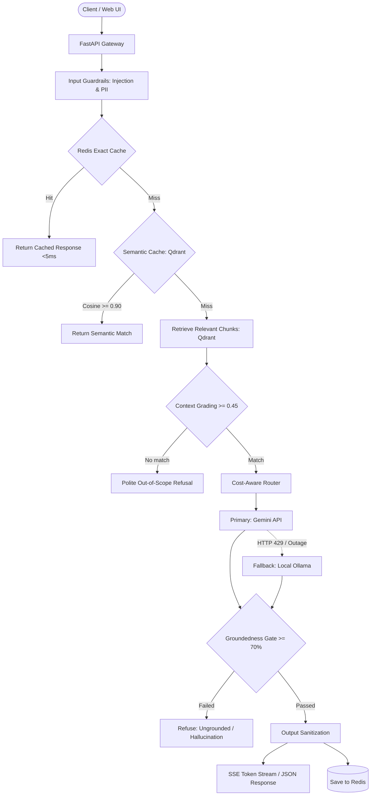

# Sentinel

Sentinel is an open-source, resilient LLMOps gateway and RAG service built on FastAPI, LangGraph, Qdrant, and Redis. It sits between client applications and foundation models, ensuring that domain answers are grounded in private documentation, hallucinations are caught before they reach users, and traffic continues flowing even when upstream APIs hit rate limits.

---

## Architecture

Sentinel processes questions through a structured state machine rather than a black-box chain:



### Request Flow
1. **Sanitization & Cache Lookup**: The gateway checks inputs for prompt injection and masks PII. It then queries a Redis exact-match cache (`SHA-256`) followed by a Qdrant semantic cache.
2. **Retrieval & Context Grading**: If un-cached, local embeddings (`BAAI/bge-small-en-v1.5`) retrieve top matches from Qdrant. A grading node drops low-confidence chunks.
3. **Resilient Routing**: Queries route to Google Gemini by default. If Gemini returns `429 Too Many Requests` or fails after 3 exponential backoff retries, traffic routes to a local Ollama instance (`qwen2.5:3b`).
4. **Groundedness Gate**: Before any response leaves the gateway, a runtime evaluator computes token overlap between the answer and retrieved source text. If groundedness is under 70%, Sentinel discards the answer to prevent hallucinations.
5. **Background Ingestion**: Documents uploaded via `/v1/ingest/jobs` go into a Redis Stream (`sentinel:stream:ingest_jobs`) and are processed asynchronously by worker processes.

---

## Quickstart

### 1. Local Development

Requires Python 3.11+, Docker (for Redis and Qdrant), and an optional Gemini API key.

```bash
# Clone and enter repo
git clone https://github.com/your-org/sentinel.git
cd sentinel

# Set up virtualenv
python -m venv .venv
.\.venv\Scripts\Activate.ps1       # On Windows PowerShell
# source .venv/bin/activate        # On Linux / macOS

# Install package in editable mode
pip install -e ".[dev]"

# Start supporting datastores
docker compose up -d redis qdrant jaeger

# Configure environment
cp .env.example .env
# Set GEMINI_API_KEY in .env

# Start dev server with hot reload
uvicorn sentinel.main:app --reload --port 8000
```

The web UI is accessible at `http://localhost:8000/ui` and API documentation at `http://localhost:8000/docs`.

---

### 2. Docker Compose

To run the complete system (API, Worker, Qdrant, Redis, Jaeger) inside containers:

```bash
docker compose up -d --build

# Ingest initial documentation
docker compose exec api python scripts/ingest.py --docs-dir data/docs
```

Exposed ports:
* Web UI: `http://localhost:8000/ui`
* API: `http://localhost:8000`
* Jaeger UI: `http://localhost:16686`
* Qdrant: `http://localhost:6333`

---

### 3. Kubernetes (Kind & Helm)

Sentinel includes a production-ready Helm chart (`deploy/helm/sentinel`) and an automated Argo CD application manifest (`deploy/argocd`).

```bash
# Create a multi-node local cluster with ingress ports
make kind-up

# Lint and install chart
make helm-lint
make helm-install
```

To clean up:
```bash
make kind-down
```

---

## API Reference

### Endpoints

| Method | Path | Description |
|---|---|---|
| `POST` | `/v1/chat` | Synchronous chat query returning answer, citations, and metadata. |
| `POST` | `/v1/chat/stream` | Server-Sent Events (SSE) token stream with citations and final audit meta. |
| `POST` | `/v1/ingest/jobs` | Enqueue documents into Redis Streams for async indexing. Returns 202. |
| `GET` | `/v1/ingest/jobs/{id}` | Check ingestion job progress percentage and status. |
| `POST` | `/v1/feedback` | Submit user ratings (👍/👎), qualitative comments, and corrections. |
| `GET` | `/v1/feedback/stats` | Aggregated user satisfaction metrics and rating counts. |
| `GET` | `/v1/feedback/export` | Export corrected feedback pairs for fine-tuning or DPO alignment. |
| `GET` | `/healthz` | Liveness probe for container orchestrators. |
| `GET` | `/readyz` | Readiness probe verifying Redis and Qdrant connections. |
| `GET` | `/ui` | Full-screen web chat client with built-in feedback buttons. |

---

### Examples

#### Stream an answer (SSE)
```bash
curl -N -X POST http://localhost:8000/v1/chat/stream \
  -H "Content-Type: application/json" \
  -d '{"question": "How do Kubernetes Deployments roll out updates?"}'
```

Output events:
```text
event: token
data: {"token": "Deployments "}

event: token
data: {"token": "use a RollingUpdate strategy..."}

event: sources
data: [{"source": "deployments.md", "content": "...", "score": 0.84}]

event: done
data: {"meta": {"latency_ms": 182.4, "model": "gemini-3.8-flash", "groundedness_score": 0.94}}
```

#### Enqueue a document for background ingestion
```bash
curl -X POST http://localhost:8000/v1/ingest/jobs \
  -H "Content-Type: application/json" \
  -d '{
    "documents": [
      {
        "source": "policies.md",
        "content": "All clusters must run non-root containers with read-only root filesystems.",
        "metadata": {"dept": "security"}
      }
    ]
  }'
```

Response:
```json
{
  "job_id": "job_ad90fa70e9fa",
  "status": "queued",
  "total_documents": 1,
  "created_at": "2026-10-18T20:03:37.696545+00:00"
}
```

---

## Evaluation and Quality Gate

Sentinel uses a local benchmark runner to measure RAG quality against a golden dataset (`data/evals/golden_dataset.json`). It tests three core metrics (the RAG Triad):
* **Context Recall**: Did retrieval fetch the documents needed to answer the question?
* **Groundedness**: Is every factual claim in the answer supported by retrieved chunks?
* **Answer Relevance**: Did the model actually answer what was asked?

```bash
# Run the benchmark offline (0 cost, uses deterministic mock provider)
make eval-gate
```

Sample output:
```text
==================================================
  Sentinel RAG Automated Quality & Groundedness Gate
==================================================
Dataset:            data/evals/golden_dataset.json
Target Groundedness: >= 70.0%

Benchmark Summary:
  * Total Samples:              8
  * Mean Groundedness:          75.0%
  * Mean Context Recall:        100.0%
  * Gate Pass Rate:             75.0%
  * Unanswerable Refusal Rate:  100.0%

Final Verdict: >>> PASSED (Quality Gate OK) <<<
```

The GitHub Actions workflow (`.github/workflows/perf-gate.yml`) runs this gate on every pull request. If groundedness regresses below 70%, the build fails and blocks the PR.

---

## Configuration

Configuration values are read from `.env` or system environment variables:

| Variable | Default | Purpose |
|---|---|---|
| `ENVIRONMENT` | `development` | App environment (`development`, `staging`, `production`). |
| `LOG_LEVEL` | `INFO` | Output log level (`DEBUG`, `INFO`, `WARNING`, `ERROR`). |
| `HOST` | `0.0.0.0` | API bind address. |
| `PORT` | `8000` | API bind port. |
| `GEMINI_API_KEY` | `""` | Google AI Studio or Vertex API key. Falls back to mock if blank. |
| `GEMINI_MODEL` | `gemini-3.8-flash` | Primary Gemini model identifier. |
| `OLLAMA_BASE_URL` | `http://localhost:11434` | Endpoint for local Ollama fallback. |
| `OLLAMA_MODEL` | `qwen2.5:3b` | Local fallback model name. |
| `QDRANT_URL` | `http://localhost:6333` | Qdrant vector database URL. |
| `QDRANT_COLLECTION` | `sentinel_docs` | Qdrant collection for document storage. |
| `EMBEDDING_MODEL` | `BAAI/bge-small-en-v1.5` | Dense local embeddings model (runs on CPU). |
| `REDIS_URL` | `redis://localhost:6379/0` | Redis instance for cache and job streams. |
| `CACHE_ENABLED` | `true` | Toggles exact match cache. |
| `CACHE_TTL_SECONDS` | `3600` | TTL for exact match entries. |
| `SEMANTIC_CACHE_ENABLED`| `true` | Toggles semantic cosine cache. |
| `SEMANTIC_CACHE_THRESHOLD` | `0.90` | Cosine similarity threshold for semantic cache hits. |
| `COST_ROUTING_ENABLED` | `false` | Enables complexity classifier to route simple queries to Ollama. |
| `GUARDRAILS_ENABLED` | `true` | Enables input safety and prompt injection checks. |
| `GROUNDEDNESS_GATE_ENABLED` | `true` | Enforces minimum factual overlap before returning answers. |
| `GROUNDEDNESS_THRESHOLD` | `0.70` | Cutoff ratio for groundedness check. |
| `OTEL_ENABLED` | `true` | Enables OpenTelemetry trace export. |
| `OTEL_EXPORTER_OTLP_ENDPOINT` | `http://localhost:4318/v1/traces` | OTLP HTTP collector endpoint (Jaeger). |

---

## Makefile Commands

```bash
make help          # Show all available commands
make install       # Install project dependencies
make lint          # Run ruff check and format inspection
make format        # Format code using ruff
make typecheck     # Run mypy on source and tests
make test          # Run pytest test suite
make ingest        # Ingest files from data/docs into Qdrant
make eval-gate     # Run offline evaluation benchmark
make kind-up       # Create local Kind Kubernetes cluster
make kind-down     # Destroy local Kind cluster
make helm-lint     # Validate Helm chart syntax
make helm-install  # Deploy Helm chart locally
make clean         # Delete cache and build artifacts
```

---

## Project Structure

```text
sentinel/
├── sentinel/
│   ├── agent/         # LangGraph workflow, context grading, and state
│   ├── api/           # FastAPI routers, models, middleware, and UI
│   ├── core/          # Pydantic configuration, structured logging, OpenTelemetry
│   ├── evals/         # Groundedness gate, RAG Triad metrics, evaluation harness
│   ├── guardrails/    # Input/output safety filters and PII masking
│   ├── llm/           # Gemini provider, Ollama provider, cost routing logic
│   ├── rag/           # Qdrant integration, text chunking, local embeddings
│   └── workers/       # Redis Streams consumer and async ingestion worker
├── deploy/
│   ├── argocd/        # Declarative Argo CD application manifests
│   ├── helm/sentinel/ # Helm chart (deployments, worker, ingress, HPA)
│   └── kind/          # Multi-node Kind cluster configuration
├── scripts/
│   ├── evaluate.py    # Offline evaluation runner and gate CLI
│   └── ingest.py      # Batch doc ingestion utility
├── tests/
│   ├── unit/          # Unit tests (mocked datastores and LLMs)
│   └── integration/   # Integration tests
└── docker-compose.yml # Compose configuration for full local stack
```

---

## Roadmap

- [x] **Phase 1**: Core RAG Gateway (FastAPI, LangGraph, Qdrant, Redis, Ollama fallback)
- [x] **Phase 2**: OpenTelemetry Tracing & Observability (OTLP export to Jaeger)
- [x] **Phase 3**: Automated Evaluation Harness & Groundedness Gate
- [x] **Phase 4**: Input/Output Guardrails, Semantic Vector Cache, Cost Router
- [x] **Phase 5**: Real-Time SSE Token Streaming, Redis Streams Queue, Web UI
- [x] **Phase 6**: Helm Charts, Local Kind Cluster, Argo CD GitOps, PR Quality Gate
- [x] **Phase 7**: Closed-Loop Feedback (`/v1/feedback`), Fine-Tuning & DPO Export (`scripts/export_feedback.py`), Automated Locust Load Testing (`tests/load`)

---

## License

MIT
