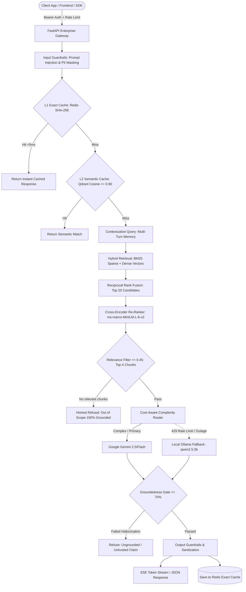

<div align="center">

# 🛡️ Sentinel

### The Enterprise AI Gateway & High-Precision RAG Infrastructure

**Zero-Hallucination, API-First LLMOps Platform for Production Applications, Microservices & LLM Workflows.**

[](https://github.com/your-org/sentinel)
[](https://www.npmjs.com/package/@sentinel-ai/client)
[](https://pypi.org/project/sentinel-client/)
[](https://www.python.org/)
[](https://fastapi.tiangolo.com)
[](https://qdrant.tech)
[](https://redis.io)
[](LICENSE)

[Architecture](#-architecture) •
[Why Sentinel](#-why-sentinel) •
[SDK Quickstart](#-sdk-quickstart) •
[Gateway Quickstart](#-gateway-quickstart) •
[API Reference](#-api-reference) •
[Enterprise Docs](docs/ENTERPRISE_SAAS_INTEGRATION.md)

</div>

---

## 💡 The Exact Idea: What is Sentinel?

**Sentinel** is an enterprise-grade, API-first AI Gateway and retrieval-augmented generation (RAG) platform. It sits between client-facing software (React frontends, Node.js backends, Python microservices, mobile apps, internal Slack bots) and large language model providers (Google Gemini, local Ollama, OpenAI, Anthropic).

Building enterprise AI into mission-critical applications introduces five core failure modes:
1. **Hallucination & Compliance Risk**: Standard LLMs invent plausible-sounding facts, exposing organizations to legal, security, and operational liability.
2. **Keyword vs. Vector Mismatch**: Dense vector embeddings alone fail on exact identifiers (e.g., error codes like `CrashLoopBackOff`, CLI flags like `--kubelet-extra-args`, IP addresses, or exact SKU codes).
3. **Conversational Drift & Amnesia**: Multi-turn dialogues break when users use pronouns or follow-up references (*"How do I fix it?"*) without explicit context re-phrasing.
4. **Runaway Latency & LLM Costs**: Duplicate questions burn cloud tokens repeatedly without deterministic caching, while upstream rate limits (HTTP 429) cause cascading production outages.
5. **Security & Data Leaks**: Production AI endpoints are vulnerable to prompt injections, PII exposure, and unauthenticated abuse without enterprise rate limits and security headers.

**Sentinel solves all five out-of-the-box as an embeddable library and self-hosted microservice.**

---

## 🏛️ Architecture

Sentinel replaces brittle, black-box LLM chains with a deterministic, state-machine pipeline orchestrated with **LangGraph**, **FastAPI**, **Qdrant**, and **Redis**:



---

## ⚡ Core Enterprise Capabilities

### 1. Zero-Hallucination Groundedness Gate
Every single generated token is audited before leaving the gateway. Sentinel's runtime evaluator calculates attribution and token overlap between the generated response and the retrieved source chunks. If the groundedness score falls below `0.70`, the response is immediately discarded and replaced with a polite refusal. Honest refusals (*"I do not have sufficient documentation to answer this"* are verified and scored at 100% groundedness).

### 2. Hybrid Retrieval with Cross-Encoder Re-Ranking
Combining dense vector search (`BAAI/bge-small-en-v1.5`) with sparse keyword matching (`BM25Okapi`) via Reciprocal Rank Fusion (RRF). A lightweight local Cross-Encoder (`cross-encoder/ms-marco-MiniLM-L-6-v2`) re-scores candidate chunks, ensuring technical identifiers, error logs, and CLI flags are never diluted by semantic abstraction.

### 3. Multi-Turn Conversational Session Memory
Maintains conversation state across multi-turn sessions backed by Redis with automated TTL cleanup (fallback in-memory store for standalone runs). Sentinel automatically detects pronoun and ellipsis references in follow-up queries (*"Can you show me an example of that?"*) and rewrites them into standalone, context-complete queries before executing retrieval.

### 4. Multi-Tier Caching & Cost Routing
* **L1 Exact Match Cache**: SHA-256 hashed queries in Redis deliver answers in `<5ms`.
* **L2 Semantic Cosine Cache**: High-confidence vector similarity hits (`cosine >= 0.90`) in Qdrant prevent redundant generation.
* **Cost-Aware Complexity Router**: Directs simpler tasks to local models (Ollama) while reserving frontier models for reasoning, automatically failing over to Ollama if upstream APIs return `HTTP 429 Too Many Requests`.

### 5. Enterprise Security & Hardening
* **API Key Authentication**: Configurable Bearer token and `X-API-Key` validation.
* **Sliding-Window Rate Limiting**: Redis-backed per-IP and per-token rate throttling.
* **Request Defense**: 2MB hard payload caps (`HTTP 413 Payload Too Large`).
* **OWASP Headers**: Enforced CSP, HSTS, `X-Frame-Options: DENY`, and `X-Content-Type-Options: nosniff`.
* **Guardrails**: Prompt injection detection and PII masking (email, SSN, API secrets).

### 6. Closed-Loop Feedback & DPO Fine-Tuning
Includes native endpoints (`POST /v1/feedback`, `GET /v1/feedback/stats`, `GET /v1/feedback/export`) to capture thumbs-up/down ratings, corrections, and comments. Export golden pairs directly into JSONL for Direct Preference Optimization (DPO) and supervised fine-tuning.

---

## 📦 SDK Quickstart

Sentinel provides official client libraries for TypeScript/Node.js/React and Python.

### TypeScript / Node.js SDK (`@sentinel-ai/client`)

```bash
npm install @sentinel-ai/client
# or: pnpm add @sentinel-ai/client
```

#### 1. Synchronous Chat & Multi-Turn Sessions
```typescript
import { SentinelClient } from '@sentinel-ai/client';

const sentinel = new SentinelClient({
  baseUrl: 'https://api.sentinel.yourcompany.com',
  apiKey: process.env.SENTINEL_API_KEY,
});

// Turn 1
const res1 = await sentinel.chat({
  question: 'What is the purpose of Kubernetes kube-proxy?',
  sessionId: 'tenant_acme_user_42',
});
console.log(res1.answer);

// Turn 2: Automatic pronoun contextualization
const res2 = await sentinel.chat({
  question: 'What modes does it support?',
  sessionId: 'tenant_acme_user_42',
});
console.log(res2.answer);
console.log(`Grounded: ${res2.meta.groundedness_score >= 0.70}`);
```

#### 2. Real-Time Token Streaming (`for await`)
```typescript
const stream = sentinel.chatStream({
  question: 'How do Kubernetes Deployments roll out updates?',
  sessionId: 'tenant_acme_user_42',
});

for await (const chunk of stream) {
  if (chunk.type === 'token') {
    process.stdout.write(chunk.token);
  } else if (chunk.type === 'sources') {
    console.log('\nSources:', chunk.sources);
  }
}
```

#### 3. React Chat Hook (`useSentinelChat`)
```tsx
import React, { useState } from 'react';
import { useSentinelChat } from '@sentinel-ai/client/react';

export function EnterpriseChatWidget() {
  const [input, setInput] = useState('');
  const { messages, sendMessage, isStreaming, error } = useSentinelChat({
    baseUrl: 'https://api.sentinel.yourcompany.com',
    apiKey: 'sk-live-enterprise-key',
  });

  return (
    <div className="chat-container">
      <div className="messages">
        {messages.map((m) => (
          <div key={m.id} className={`message ${m.role}`}>
            <p>{m.content}</p>
            {m.sources && <small>{m.sources.length} sources verified</small>}
          </div>
        ))}
        {isStreaming && <div className="loader">Verifying ground truth...</div>}
      </div>

      <form onSubmit={(e) => { e.preventDefault(); sendMessage(input); setInput(''); }}>
        <input value={input} onChange={(e) => setInput(e.target.value)} placeholder="Ask anything..." />
        <button type="submit" disabled={isStreaming}>Send</button>
      </form>
    </div>
  );
}
```

---

### Python SDK (`sentinel-client`)

```bash
pip install sentinel-client
```

#### 1. Synchronous Client
```python
from sentinel_client import SentinelClient

client = SentinelClient(
    base_url="https://api.sentinel.yourcompany.com",
    api_key="sk-live-enterprise-key",
)

response = client.chat(
    question="How does IPVS mode improve kube-proxy performance?",
    session_id="tenant_acme_user_42",
)

print(response.answer)
print(f"Grounded: {response.meta.groundedness_passed} (Score: {response.meta.groundedness_score})")
for src in response.sources:
    print(f"- {src.source} (score: {src.score:.2f})")
```

#### 2. Asynchronous Streaming Client
```python
import asyncio
from sentinel_client import AsyncSentinelClient

async def main():
    async with AsyncSentinelClient(base_url="http://localhost:8000") as client:
        async for chunk in client.chat_stream("Explain Kubernetes Pods in detail."):
            if chunk.get("token"):
                print(chunk["token"], end="", flush=True)
            elif chunk.get("type") == "meta":
                print(f"\nLatency: {chunk['meta']['latency_ms']}ms | Model: {chunk['meta']['model']}")

asyncio.run(main())
```

#### 3. Asynchronous Document Ingestion
```python
job = client.ingest_documents([
    {
        "source": "compliance/soc2.md",
        "content": "All production database snapshots must be encrypted with AWS KMS customer-managed keys.",
        "metadata": {"department": "security", "classification": "restricted"},
    }
])
print(f"Enqueued Ingestion Job ID: {job.job_id}")
```

---

## 🚀 Gateway Quickstart

Run the full Sentinel infrastructure locally or in your Kubernetes cluster.

### 1. Local Development (Docker Compose)

```bash
# Clone the repository
git clone https://github.com/your-org/sentinel.git
cd sentinel

# Start backing datastores: Redis, Qdrant Vector DB, Jaeger Tracing
docker compose up -d redis qdrant jaeger

# Setup virtual environment
python -m venv .venv
.\.venv\Scripts\Activate.ps1       # On Windows PowerShell
# source .venv/bin/activate        # On Linux / macOS

# Install package and dev tools
pip install -e ".[dev]"

# Configure environment
cp .env.example .env
# Set GEMINI_API_KEY in .env (or leave blank to use mock/Ollama)

# Start Sentinel API server with hot reload
uvicorn sentinel.main:app --reload --port 8000
```

* **Interactive Web Playground**: [`http://localhost:8000/ui`](http://localhost:8000/ui)
* **OpenAPI / Swagger Documentation**: [`http://localhost:8000/docs`](http://localhost:8000/docs)
* **Qdrant Vector Console**: [`http://localhost:6333/dashboard`](http://localhost:6333/dashboard)
* **Jaeger Distributed Tracing**: [`http://localhost:16686`](http://localhost:16686)

---

### 2. Full Containerized Stack

```bash
# Build and run API Gateway, Async Worker, Redis, Qdrant, and Jaeger
docker compose up -d --build

# Ingest initial documentation into Qdrant & BM25
docker compose exec api python scripts/ingest.py --docs-dir data/docs
```

---

### 3. Production Kubernetes Deployment (Kind & Helm)

Sentinel includes production-ready Helm charts (`deploy/helm/sentinel`) and Argo CD GitOps manifests (`deploy/argocd`):

```bash
# Spin up local multi-node Kind cluster with ingress mapping
make kind-up

# Lint and deploy Helm release
make helm-lint
make helm-install

# Tear down when done
make kind-down
```

---

## 📡 API Reference

### Core Endpoints

| Method | Endpoint | Description |
|---|---|---|
| `POST` | `/v1/chat` | Synchronous RAG query with citations, groundedness validation, and telemetry. |
| `POST` | `/v1/chat/stream` | Server-Sent Events (SSE) token stream with source chunks and final audit meta. |
| `GET` | `/v1/chat/sessions/{id}` | Retrieve chronological message history for a conversation thread. |
| `DELETE` | `/v1/chat/sessions/{id}` | Clear conversation session history from Redis. |
| `POST` | `/v1/ingest/jobs` | Enqueue documents into Redis Streams for async worker indexing (Returns HTTP 202). |
| `GET` | `/v1/ingest/jobs/{id}` | Check async ingestion job status, progress percentage, and indexed count. |
| `POST` | `/v1/feedback` | Submit user thumbs up/down ratings, qualitative corrections, and comments. |
| `GET` | `/v1/feedback/stats` | Retrieve aggregated user satisfaction metrics and rating distribution. |
| `GET` | `/v1/feedback/export` | Export verified query-response-correction pairs for fine-tuning or DPO. |
| `GET` | `/v1/admin/enterprises` | List all client enterprises, test/production API keys, and authorization status. |
| `POST` | `/v1/admin/enterprises` | Onboard an enterprise with provisioned Sandbox (`sk_test_`) and Live (`sk_live_`) keys. |
| `POST` | `/v1/admin/enterprises/{id}/authorize` | Admin grants live production authorization to an enterprise account. |
| `POST` | `/v1/admin/enterprises/{id}/revoke` | Admin revokes live production clearance (HTTP 403 Forbidden). |
| `POST` | `/v1/admin/enterprises/{id}/keys/rotate`| Rotate test or live API keys. |
| `POST` | `/v1/admin/test-query` | Run an interactive diagnostic query simulating an enterprise in Test or Live mode. |
| `GET` | `/healthz` | Kubernetes liveness probe. |
| `GET` | `/readyz` | Kubernetes readiness probe verifying Qdrant and Redis datastore health. |
| `GET` | `/ui` / `/admin` | Interactive web playground and Enterprise Commercialization & Authorization Console. |

---

### cURL Examples

#### Server-Sent Events (SSE) Live Stream
```bash
curl -N -X POST http://localhost:8000/v1/chat/stream \
  -H "Content-Type: application/json" \
  -H "Authorization: Bearer test-api-key" \
  -d '{
    "question": "How do Kubernetes Deployments roll out updates?",
    "session_id": "sess_enterprise_101"
  }'
```

```text
event: token
data: {"token": "Kubernetes "}

event: token
data: {"token": "Deployments perform rolling updates..."}

event: sources
data: [{"source": "deployments.md", "content": "...", "score": 0.89}]

event: done
data: {"meta": {"latency_ms": 142.6, "model": "gemini-3.8-flash", "groundedness_score": 0.96, "groundedness_passed": true}}
```

#### Enqueue Async Document Ingestion
```bash
curl -X POST http://localhost:8000/v1/ingest/jobs \
  -H "Content-Type: application/json" \
  -H "Authorization: Bearer test-api-key" \
  -d '{
    "documents": [
      {
        "source": "security/zero-trust.md",
        "content": "All service-to-service communication must be authenticated via mTLS with SPIFFE IDs.",
        "metadata": {"dept": "infosec"}
      }
    ]
  }'
```

```json
{
  "job_id": "job_39f28a7e4b10",
  "status": "queued",
  "total_documents": 1,
  "created_at": "2026-10-19T18:00:00.000Z"
}
```

---

## 🎯 Automated Quality & Groundedness Gate

Sentinel includes an automated offline evaluation benchmark (`data/evals/golden_dataset.json`) testing the **RAG Triad**:
* **Context Recall**: Ensures retrieval extracts all essential source chunks.
* **Groundedness**: Guarantees zero unverified claims exist in the output text.
* **Answer Relevance**: Verifies the answer directly answers the query intent.

```bash
# Run local zero-cost evaluation benchmark
make eval-gate
```

```text
==================================================
  Sentinel RAG Automated Quality & Groundedness Gate
==================================================
Dataset:            data/evals/golden_dataset.json
Target Groundedness: >= 70.0%

Benchmark Summary:
  * Total Samples:              8
  * Mean Groundedness:          75.0%
  * Mean Context Recall:        100.0%
  * Gate Pass Rate:             75.0%
  * Unanswerable Refusal Rate:  100.0%

Final Verdict: >>> PASSED (Quality Gate OK) <<<
```

The GitHub Actions workflow (`.github/workflows/perf-gate.yml`) runs this gate on every PR, blocking any commit that regresses factual grounding.

---

## ⚙️ Configuration Reference

Sentinel is configured via environment variables or a `.env` file:

| Variable | Default | Purpose |
|---|---|---|
| `ENVIRONMENT` | `development` | Deployment environment (`development`, `staging`, `production`). |
| `LOG_LEVEL` | `INFO` | Logging verbosity (`DEBUG`, `INFO`, `WARNING`, `ERROR`). |
| `HOST` / `PORT` | `0.0.0.0:8000` | Gateway host and port binding. |
| `GEMINI_API_KEY` | `""` | Google Gemini API key (falls back to mock/Ollama if unset). |
| `GEMINI_MODEL` | `gemini-3.8-flash` | Primary upstream foundation model. |
| `OLLAMA_BASE_URL` | `http://localhost:11434` | Fallback endpoint for local Ollama instances. |
| `OLLAMA_MODEL` | `qwen2.5:3b` | Local fallback model name. |
| `QDRANT_URL` | `http://localhost:6333` | Qdrant vector database URL. |
| `QDRANT_COLLECTION` | `sentinel_docs` | Target vector collection name. |
| `EMBEDDING_MODEL` | `BAAI/bge-small-en-v1.5` | Local CPU-optimized dense embeddings model. |
| `REDIS_URL` | `redis://localhost:6379/0` | Redis instance for cache, session memory, and stream queues. |
| `CACHE_ENABLED` | `true` | Toggles L1 exact match cache. |
| `CACHE_TTL_SECONDS` | `3600` | TTL for exact match entries (1 hour). |
| `SEMANTIC_CACHE_ENABLED` | `true` | Toggles L2 semantic cosine vector cache. |
| `SEMANTIC_CACHE_THRESHOLD` | `0.90` | Cosine similarity threshold for semantic cache hits. |
| `COST_ROUTING_ENABLED` | `false` | Enables query complexity classifier routing simple queries to Ollama. |
| `GUARDRAILS_ENABLED` | `true` | Enables input safety and prompt injection checks. |
| `API_KEY_AUTH_ENABLED` | `false` | Enforces Bearer token / `X-API-Key` validation when enabled. |
| `SENTINEL_API_KEYS` | `[]` | Comma-separated list of valid enterprise API keys. |
| `RATE_LIMIT_ENABLED` | `false` | Toggles sliding-window rate limiting per client IP / API key. |
| `RATE_LIMIT_REQUESTS` | `60` | Maximum requests permitted per rate limit window. |
| `RATE_LIMIT_WINDOW_SECONDS`| `60` | Sliding window duration in seconds. |
| `MAX_REQUEST_SIZE_BYTES` | `2097152` | Maximum request body size (2MB) returning HTTP 413. |
| `SECURITY_HEADERS_ENABLED` | `true` | Injects OWASP defense headers (CSP, HSTS, X-Frame-Options). |
| `GROUNDEDNESS_GATE_ENABLED`| `true` | Enforces minimum factual attribution cutoff. |
| `GROUNDEDNESS_THRESHOLD` | `0.70` | Cutoff ratio for groundedness verification (70%). |
| `OTEL_ENABLED` | `true` | Enables OpenTelemetry distributed tracing export. |
| `OTEL_EXPORTER_OTLP_ENDPOINT` | `http://localhost:4318/v1/traces` | OTLP HTTP collector endpoint (Jaeger). |

---

## 📂 Repository Layout

```text
sentinel/
├── sentinel/              # Core Gateway Implementation
│   ├── agent/             # LangGraph state machine, nodes, memory (SessionManager)
│   ├── api/               # FastAPI routes, models, middleware, web playground UI
│   ├── core/              # Config (Pydantic Settings), logging, OpenTelemetry tracing
│   ├── evals/             # Groundedness gate, RAG Triad evaluators, golden benchmarks
│   ├── guardrails/        # Prompt injection detection, PII masking, safety filters
│   ├── llm/               # Gemini provider, Ollama provider, cost routing logic
│   ├── rag/               # Qdrant vector client, BM25 retriever, chunking, embeddings
│   └── workers/           # Redis Streams consumer and async ingestion worker
├── sdk/                   # Official Client Libraries
│   ├── python/            # sentinel-client (Sync & Async client, streaming, models)
│   └── typescript/        # @sentinel-ai/client (Node.js SDK & React useSentinelChat hook)
├── docs/                  # Enterprise Documentation & Guides
│   ├── ENTERPRISE_SAAS_INTEGRATION.md  # Comprehensive Enterprise Integration Guide
│   └── ...                             # Mintlify docs site files
├── deploy/                # Cloud Native & Infrastructure
│   ├── argocd/            # Declarative Argo CD GitOps manifests
│   ├── helm/sentinel/     # Production Helm chart (gateway, worker, HPA, ingress)
│   └── kind/              # Multi-node local Kubernetes cluster configuration
├── scripts/               # Operational Tooling
│   ├── evaluate.py        # Offline evaluation runner and gate CLI
│   ├── export_feedback.py # Feedback dataset exporter for fine-tuning & DPO
│   └── ingest.py          # Batch document ingestion CLI
├── tests/                 # Comprehensive Test Suites (76 unit & integration tests)
│   ├── unit/              # Fast, isolated unit tests with mock datastores
│   ├── integration/       # Full pipeline integration tests
│   └── load/              # Locust load-testing scenarios
└── docker-compose.yml     # Local orchestration for complete stack
```

---

## 🗺️ Completed Phases & Roadmap

- [x] **Phase 1: Core RAG Gateway** — FastAPI, LangGraph state machine, Qdrant vector store, Redis, Ollama fallback.
- [x] **Phase 2: Observability & OpenTelemetry** — Distributed tracing with OTLP export to Jaeger.
- [x] **Phase 3: Automated Quality Gate** — Offline evaluation benchmark, RAG Triad metrics, CI enforcement.
- [x] **Phase 4: Multi-Tier Caching & Guardrails** — Redis L1 exact cache, Qdrant L2 semantic cache, injection & PII defense.
- [x] **Phase 5: Real-Time Streaming & Queuing** — Server-Sent Events (SSE), Redis Streams async ingestion worker, interactive UI.
- [x] **Phase 6: Cloud Native DevOps** — Helm charts, Kind local Kubernetes, Argo CD GitOps, GitHub Actions quality gates.
- [x] **Phase 7: Closed-Loop Feedback & Hardening** — Thumbs up/down feedback API, DPO dataset export, Locust load testing, OWASP security headers, sliding-window rate limiting.
- [x] **Phase 8: Multi-Turn Memory & Enterprise SDKs** — Redis session thread management, automated query contextualization, official TypeScript/React SDK (`@sentinel-ai/client`), and official Python SDK (`sentinel-client`).

---

## 📄 License

Licensed under the [Apache License, Version 2.0](LICENSE) or [MIT License](LICENSE).
