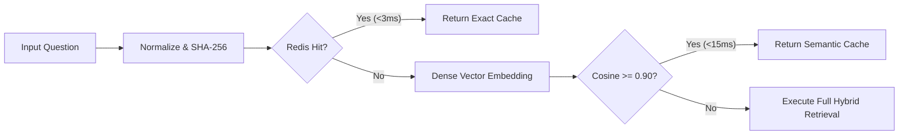

Repeated questions in enterprise environments consume excessive LLM token costs and introduce avoidable latency. Sentinel implements a **two-tier caching architecture** that intercepts identical and semantically equivalent queries.

---

## Tier 1: Exact Match Cache (Redis)

The first cache check is performed against Redis:
1. The user's input question is normalized (lowercased, stripped of leading/trailing whitespace, punctuation cleaned).
2. A cryptographic **SHA-256** hash is generated:
   ```python
   cache_key = f"sentinel:cache:{hashlib.sha256(normalized_text.encode()).hexdigest()}"
   ```
3. If the key exists in Redis, the cached JSON response (including sources and execution metadata) is returned immediately in under **3 milliseconds**.

### Cache Invalidation & Expiration
* **TTL (Time to Live)**: Configurable via `CACHE_TTL_SECONDS` (default: 3600 seconds / 1 hour).
* **Purge on Re-index**: When new documentation is ingested, cache keys can be invalidated to prevent stale answers.

---

## Tier 2: Semantic Cache (Qdrant)

When an exact match fails, Sentinel checks for **semantic similarity**. If a user asks *"How do I restart a deployment?"* and another asks *"What is the command to rollout restart a kubernetes deployment?"*, the semantic cache detects their intent equivalence.

1. The query is embedded via `BAAI/bge-small-en-v1.5` into a 384-dimensional dense vector.
2. Qdrant is queried across the `sentinel_cache` collection with cosine similarity.
3. If the nearest neighbor has a cosine similarity $\ge 0.90$ (configurable), Sentinel returns the pre-computed verified answer.



---

## Configuration Reference

| Environment Variable | Default | Description |
| :--- | :--- | :--- |
| `CACHE_ENABLED` | `true` | Master switch for Redis exact-match cache. |
| `REDIS_URL` | `redis://localhost:6379/0` | Connection string to Redis. |
| `CACHE_TTL_SECONDS` | `3600` | Expiration time for cached responses. |
| `SEMANTIC_CACHE_ENABLED` | `true` | Master switch for Qdrant semantic cache. |
| `SEMANTIC_CACHE_THRESHOLD` | `0.90` | Minimum cosine similarity required to trigger a semantic hit. |
