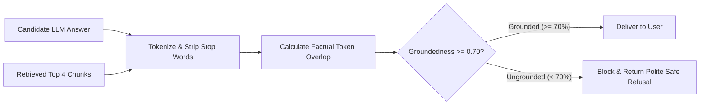

The primary barrier to deploying RAG in critical production environments is **hallucination**—when an LLM invents facts, parameters, or policies not present in the retrieved documentation.

Sentinel intercepts hallucinations before they reach the user via a deterministic, real-time **Groundedness Gate**.

---

## How Groundedness is Calculated

Rather than relying on another expensive LLM judge at runtime (which adds 500ms+ latency and its own hallucination risk), Sentinel employs a high-throughput **content-overlap evaluator**:

1. Both the candidate response and retrieved context chunks are normalized, tokenized, and stripped of non-substantive stop words.
2. The gate computes the proportion of substantive candidate claim tokens that directly appear in the retrieved context:

$$\text{Groundedness Score} = \frac{|\text{Tokens}_{\text{Answer}} \cap \text{Tokens}_{\text{Context}}|}{|\text{Tokens}_{\text{Answer}}|}$$



---

## Action on Failure

If the calculated `groundedness_score` falls below the threshold (default: **0.70** or 70%):
1. The hallucinated answer is immediately discarded.
2. Sentinel returns a safe refusal explaining that the internal knowledge base does not contain sufficient verified facts to answer the question reliably.
3. The event is recorded in OpenTelemetry telemetry with `groundedness_passed: false` for offline team auditing.

---

## Automated CI/CD Performance Gate

Sentinel tests its Groundedness Gate automatically on every pull request using a golden dataset (`data/evals/golden_dataset.json`):

```bash
make eval-gate
```

If groundedness drops below 70% across test benchmarks, GitHub Actions fails the workflow and blocks the pull request from merging into production.

---

## Configuration Reference

| Environment Variable | Default | Description |
| :--- | :--- | :--- |
| `GROUNDEDNESS_GATE_ENABLED` | `true` | Master switch for runtime groundedness verification. |
| `GROUNDEDNESS_THRESHOLD` | `0.70` | Required minimum factual overlap ratio (0.0 to 1.0). |
