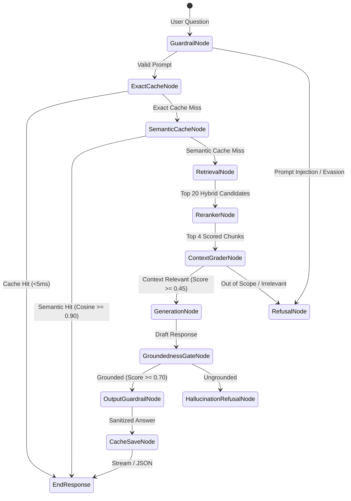

Most RAG prototypes rely on monolithic, opaque prompt chains where failures cascade silently. Sentinel replaces these chains with a **finite state machine orchestrated by LangGraph**.

Each processing stage is an independent node with typed state, deterministic branching, and telemetry hooks.

---

## State Machine Graph



---

## Agent State Schema

The entire lifecycle of a query is encapsulated in the `AgentState` schema:

```python
class AgentState(TypedDict):
    question: str
    cleaned_question: str
    documents: list[Chunk]
    answer: str
    sources: list[dict[str, Any]]
    meta: dict[str, Any]
    guardrail_passed: bool
    context_relevant: bool
    groundedness_passed: bool
    groundedness_score: float
    cache_hit: bool
    session_id: str | None
```

### State Node Responsibilities

| State Node | Function | Technology |
| :--- | :--- | :--- |
| **`guardrail_node`** | Normalizes Unicode (NFKC), strips zero-width spaces, flags injections, masks PII. | Regex, Unicode canonicalization |
| **`exact_cache_node`** | Hashes normalized question with SHA-256 and looks up exact match in Redis. | Redis String Key |
| **`semantic_cache_node`** | Embeds query and queries Qdrant for semantic duplicates above cosine $\ge 0.90$. | Qdrant Vector Collection |
| **`retrieval_node`** | Computes dense vector + sparse BM25 scores and merges via Reciprocal Rank Fusion. | `bge-small-en-v1.5`, BM25Okapi |
| **`reranker_node`** | Cross-encoder scores query-document pairs, selecting top-4 high-precision chunks. | `ms-marco-MiniLM-L-6-v2` |
| **`grader_node`** | Verifies retrieval quality. If best relevance score $< 0.45$, refuses out-of-scope query. | Deterministic Threshold Gate |
| **`generate_node`** | Prompts LLM router with retrieved context. Automatic fallback on failure. | Gemini 2.5 Flash / Ollama |
| **`gate_node`** | Evaluates candidate answer groundedness against retrieved text chunks. | Token Overlap Evaluator |
| **`output_guard_node`** | Strips XSS scripts, scrubs database connection URIs, redacts leaked keys. | Regex Scrubber |
| **`save_cache_node`** | Persists verified answers into Redis exact cache and Qdrant semantic cache. | Redis & Qdrant |

---

## Error Handling & Resiliency

* **State Preservation**: Failures in downstream dependencies (e.g. Qdrant timeout) do not crash the service. Failover paths catch exceptions gracefully and return actionable error details.
* **OpenTelemetry Trace Spans**: Every node transition creates a nested OpenTelemetry child span tagged with token counts, cache status, and execution duration.
