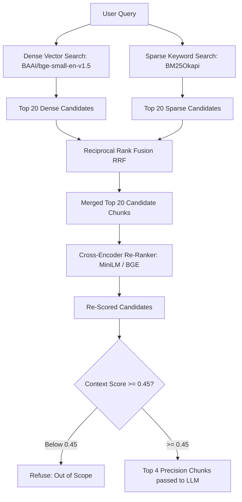

Dense vector embeddings excel at semantic paraphrasing, but often struggle with exact keyword matching—such as Kubernetes error codes (`CrashLoopBackOff`), CLI options (`--kubelet-extra-args`), or precise function names.

Sentinel solves this by pairing dense embeddings with sparse keyword search (**BM25**) and scoring candidates with a **Cross-Encoder Re-Ranker**.

---

## Retrieval Architecture



---

## 1. Reciprocal Rank Fusion (RRF)

Instead of normalizing and adding raw distance scores (which have different distributions across dense and sparse algorithms), Sentinel merges dense and sparse rankings using standard **Reciprocal Rank Fusion**:

$$RRF(d) = \sum_{m \in M} \frac{1}{k + r_m(d)}$$

Where:
* $M$ is the set of retrievers (Dense + BM25)
* $r_m(d)$ is the rank of document $d$ in retriever $m$ (1-indexed)
* $k$ is the smoothing constant (default: `60`)

Documents appearing near the top of both dense and sparse lists receive the highest cumulative RRF scores.

---

## 2. Cross-Encoder Re-Ranking

Bi-encoders (like `bge-small-en-v1.5`) encode the query and documents independently to allow fast index lookup. However, they cannot model intricate token-level interactions between the question and context.

Sentinel's Cross-Encoder (`cross-encoder/ms-marco-MiniLM-L-6-v2` or `BAAI/bge-reranker-base`) accepts query-document pairs simultaneously:

```python
score = cross_encoder.predict([(query, doc_text)])
```

The top 20 candidates are re-ordered, and only the top **4** most contextually relevant chunks are passed to the LLM context window.

---

## Configuration Reference

Configure the hybrid search and reranker parameters via `.env`:

| Setting | Default | Description |
| :--- | :--- | :--- |
| `HYBRID_SEARCH_ENABLED` | `true` | Enables dual dense + sparse retrieval. |
| `BM25_INDEX_PATH` | `data/indices/bm25_index.json` | Path to serialized BM25 inverted index. |
| `HYBRID_RRF_K` | `60` | Smoothing constant $k$ for Reciprocal Rank Fusion. |
| `RETRIEVAL_CANDIDATES_K` | `20` | Candidate pool size retrieved from each index. |
| `RERANKER_ENABLED` | `true` | Toggles the Cross-Encoder re-ranking step. |
| `RERANKER_MODEL` | `cross-encoder/ms-marco-MiniLM-L-6-v2` | Lightweight neural re-ranker model. |
| `RETRIEVAL_TOP_K` | `4` | Final number of chunks delivered to the LLM. |
| `SCORE_THRESHOLD` | `0.45` | Minimum relevance threshold required to avoid out-of-scope refusal. |
