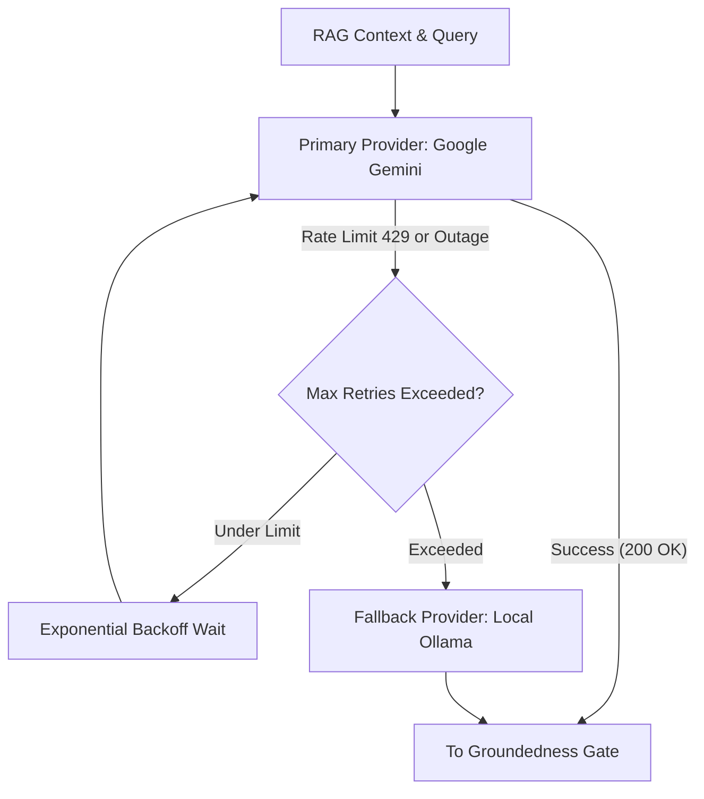

Enterprise applications cannot afford downtime when commercial LLM providers experience throttling, rate limits, or outages. Sentinel includes an intelligent **LLM Router** with built-in resilience and cost awareness.

---

## 1. Zero-Downtime Fallback Architecture

Sentinel uses **Google Gemini 2.5 Flash** as its primary cloud LLM. If the Gemini API returns `429 Too Many Requests`, `503 Service Unavailable`, or times out after exponential backoff retries, Sentinel seamlessly routes the query to an on-premise/local **Ollama** model (`qwen2.5:3b`).



### Key Benefits
* **No User-Facing Errors**: End users never see `429 Rate Limit Exceeded` errors from commercial AI providers.
* **Data Sovereignty**: During cloud network disconnections, all queries continue running entirely within the local cluster.

---

## 2. Cost-Aware Complexity Classifier

Frontier cloud models charge substantially more per thousand tokens than lightweight local models. Sentinel includes an optional **Cost Router** that scores incoming questions by complexity:

```python
is_simple = len(question.split()) < 12 and not any(
    keyword in question.lower()
    for keyword in ["compare", "analyze", "tradeoff", "evaluate", "why"]
)
```

* **Simple Definitions & Lookups** *(e.g. "What is a Pod?")*: Routed directly to the lightweight economy provider (cost: ~$0.00).
* **Deep Architectural Analysis** *(e.g. "Compare StatefulSets vs Deployments for distributed Cassandra storage")*: Routed to the primary frontier model.

---

## Configuration Reference

| Environment Variable | Default | Description |
| :--- | :--- | :--- |
| `GEMINI_API_KEY` | `""` | Google AI Studio or Vertex API key. |
| `GEMINI_MODEL` | `gemini-2.5-flash` | Primary cloud model identifier. |
| `OLLAMA_BASE_URL` | `http://localhost:11434` | Endpoint for local Ollama instance. |
| `OLLAMA_MODEL` | `qwen2.5:3b` | Local fallback model name. |
| `COST_ROUTING_ENABLED` | `false` | Enables query complexity routing. |
| `MAX_LLM_RETRIES` | `3` | Exponential backoff retry attempts before failover. |
