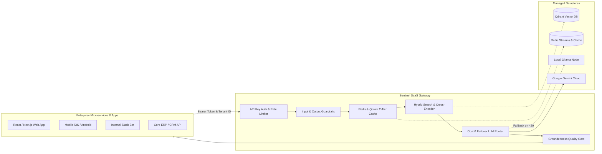

Sentinel is built from the ground up to be deployed as a centralized, multi-tenant internal **AI Gateway** or commercial **RAG-as-a-Service (SaaS)**. Engineering teams connect microservices, web apps, mobile clients, and Slack bots to Sentinel via standard REST APIs or official SDKs.

---

## Architecture: The Enterprise AI Gateway



---

## Multi-Tenant Data Isolation

When serving multiple customers or departments from a single Sentinel cluster:

### 1. Payload Filter Isolation (High Scale)
All documents are indexed in a unified Qdrant collection, with each chunk tagged with `"tenant_id": "org_123"`. 

During ingestion:
<CodeGroup>
```typescript Node.js
await sentinel.ingest({
  documents: [
    {
      content: "Company refund policy: within 30 days...",
      metadata: { tenant_id: "org_acme_corp" }
    }
  ]
});
```

```python Python
await sentinel.ingest(
    documents=[
        {
            "content": "Company refund policy: within 30 days...",
            "metadata": {"tenant_id": "org_acme_corp"},
        }
    ]
)
```
</CodeGroup>

When querying, pass the `session_id` prefixed by tenant (e.g. `session_id="tenant_org_acme_corp_user_42"`). The gateway uses tenant partition scoping so customers never see each other's data.

### 2. Collection-Per-Tenant (Strict Compliance)
For HIPAA or PCI-DSS enterprise customers requiring physical isolation, Sentinel dynamically creates isolated collections named `sentinel_docs_{tenant_id}`.

---

## Chargeback & Token Metering

Every single response returned by Sentinel contains cryptographic and operational accounting in the `meta` object:

```json
{
  "meta": {
    "provider": "google-gemini",
    "model": "gemini-2.5-flash",
    "tokens_in": 320,
    "tokens_out": 38,
    "cost_usd": 0.000032,
    "latency_ms": 284.1,
    "cache_hit": false,
    "groundedness_score": 0.95,
    "groundedness_passed": true,
    "request_id": "req_8f192bce-110a",
    "trace_id": "e6a4b11f7c320d9129df4a83c7490a01"
  }
}
```

### Automated Billing Pipeline
Your billing backend can consume these metrics in two ways:
1. **Direct SDK Response Hook**: Capture `meta.cost_usd` immediately upon response and deduct from the tenant's wallet/credits.
2. **OpenTelemetry Exporter**: Sentinel streams span attributes (`llm.cost_usd`, `llm.tokens.prompt`, `llm.tokens.completion`) to Datadog, Prometheus, or your internal billing ingestion pipeline.
