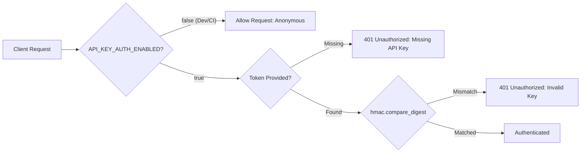

Sentinel provides native gateway-level access controls designed for zero-trust microservice environments and enterprise SaaS consumption.

---

## 1. API Key Authentication

Sentinel supports two standard authentication formats:
* **HTTP Bearer Token**: `Authorization: Bearer <key>`
* **HTTP Header**: `X-API-Key: <key>`



### Constant-Time Comparison
To protect against side-channel timing attacks (where attackers measure string comparison time to brute-force valid keys character by character), Sentinel validates keys using Python's cryptographic `hmac.compare_digest`:

```python
valid = any(
    hmac.compare_digest(provided_key, valid_key)
    for valid_key in settings.sentinel_api_keys
)
```

---

## 2. Sliding-Window Rate Limiting

To prevent denial-of-service (DoS) attacks, brute-force attacks, and rogue scripts from exhausting compute resources, Sentinel enforces a sliding-window rate limiter per client:
* **Client Identification**: Derived from the client API key if authenticated; otherwise falls back to `request.client.host`.
* **Whitelisted Probes**: Monitoring endpoints (`/health`, `/healthz`, `/ready`, `/readyz`, `/docs`, `/ui`) are exempt from rate limits so health probes are never throttled.

### 429 Response Format
When the rate limit is exceeded, Sentinel returns `HTTP 429 Too Many Requests` including standard rate limit headers:

```http
HTTP/1.1 429 Too Many Requests
Retry-After: 42
X-RateLimit-Limit: 60
X-RateLimit-Reset: 42
Content-Type: application/json

{
  "error": "Too Many Requests",
  "message": "Rate limit exceeded. Try again in 42 seconds.",
  "retry_after": 42
}
```

---

## 3. Payload Size Enforcement

Sentinel enforces a strict body size limit (default: **2 MB**) to prevent memory exhaustion and payload bombs:
* Requests with `Content-Length` exceeding `MAX_REQUEST_SIZE_BYTES` are immediately rejected with `HTTP 413 Payload Too Large`.

---

## Configuration Reference

| Environment Variable | Default | Description |
| :--- | :--- | :--- |
| `API_KEY_AUTH_ENABLED` | `false` | Set to `true` in production to enforce authentication. |
| `SENTINEL_API_KEYS` | `[]` | Comma-separated list of accepted keys (`sk-live-1,sk-live-2`). |
| `RATE_LIMIT_ENABLED` | `false` | Set to `true` to activate sliding-window rate limiting. |
| `RATE_LIMIT_REQUESTS` | `60` | Maximum requests permitted in the sliding window. |
| `RATE_LIMIT_WINDOW_SECONDS` | `60` | Duration of the sliding window in seconds. |
| `MAX_REQUEST_SIZE_BYTES` | `2097152` | Maximum allowable request body size in bytes (2 MB). |
