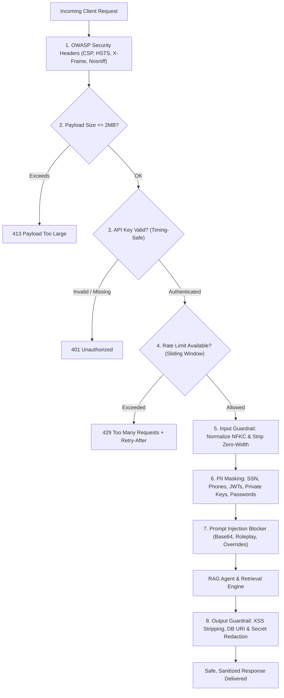

Security in enterprise AI applications requires protection across multiple boundaries: network ingress, prompt evaluation, LLM response rendering, and egress data privacy.

Sentinel implements a multi-layer **Defense-in-Depth** security model:



---

## Defense Matrix

| Attack Vector / Risk | Threat Description | Sentinel Countermeasure |
| :--- | :--- | :--- |
| **Prompt Injection** | Adversarial users attempting to hijack agent instructions | Heuristic regex inspection blocking roleplay, overrides, and delimiters |
| **Filter Evasion** | Zero-width unicode spaces inserted to bypass keyword detectors | Canonical NFKC normalization and zero-width codepoint stripping |
| **PII Data Egress** | Sensitive user data (SSN, phone, tokens) sent to cloud models | Pre-retrieval masking with pattern substitution before reaching LLMs |
| **API Abuse & DoS** | Malicious scripts exhausting compute or flood querying | In-memory sliding-window rate limiter per client IP or API key |
| **Memory Exhaustion** | Enormous payloads designed to crash Python gateway workers | Streaming payload cutoff rejecting bodies $> 2\text{MB}$ with HTTP 413 |
| **Timing Attacks** | Attackers guessing API keys via string comparison timing | Constant-time `hmac.compare_digest` verification |
| **Secret Leakage** | LLMs inadvertently echoing DB credentials or connection strings | Output regex scrubber neutralizing database URIs and private keys |
| **Cross-Site Scripting (XSS)** | Injected malicious HTML/JS rendered on client web interfaces | Output scrubber stripping `<script>`, `javascript:`, and inline handlers |

---

## Security Headers

Sentinel automatically injects OWASP-recommended HTTP response headers on every route:

```http
X-Content-Type-Options: nosniff
X-Frame-Options: DENY
Strict-Transport-Security: max-age=31536000; includeSubDomains; preload
Content-Security-Policy: default-src 'self'; script-src 'self'; style-src 'self' 'unsafe-inline';
Referrer-Policy: strict-origin-when-cross-origin
Permissions-Policy: geolocation=(), camera=(), microphone=()
```
